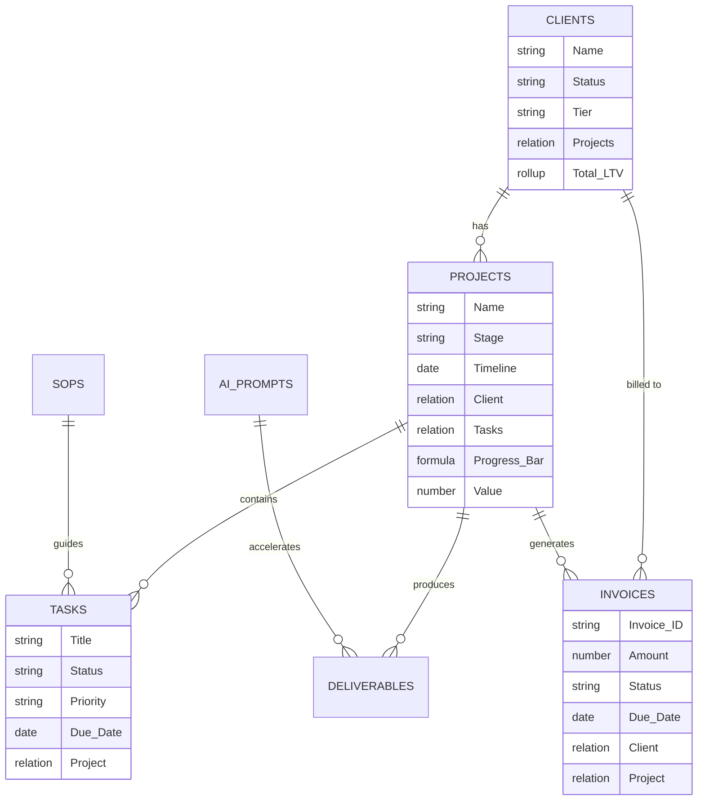

# ⚡ ForgeOS — Operating System for Freelancers & Micro-Agencies
### Complete Architectural Blueprint, Database Specifications & Notion Implementation Guide

---

## 🧭 Executive Overview
**ForgeOS** is an end-to-end, high-performance Notion Operating System tailored for solo professionals, consultants, and micro-agencies (1–5 members). It replaces disjointed tools (Trello, Asana, Google Sheets, messy docs) with a single, synchronized hub that unifies client acquisition, project delivery, billing, and operational excellence.

Designed for high perceived value ($97–$197 price point on Gumroad / Lemon Squeezy), ForgeOS adopts modern enterprise Notion design principles:
- **Clean Headless Back-end:** All master databases live inside a locked system folder (`⚙️ System Databases [Do Not Delete]`).
- **Linked Front-end Dashboards:** Pages use filtered, contextual linked database views for maximum performance and zero clutter.
- **Relational Integrity:** Clients link to Projects; Projects link to Tasks, Milestones, and Invoices; Content links to Projects and Channels.
- **Formulas & Visual Progress:** Dynamic progress bars, revenue rollup calculations, priority flags, and SLA indicators.

---

## 🏗️ Relational Data Schema (Architecture Map)

---

## 🗄️ Master Database Specifications

### 1. `[DB] 👥 Clients CRM`
| Property Name | Property Type | Options / Configuration / Formula |
|---|---|---|
| **Client Name** | Title | Company or Client contact name |
| **Status** | Select | 🟢 Active, 🟡 In Negotiation, 🔵 Past Client, 🔴 Lead / Prospect, ⚪ Churned |
| **Client Tier** | Select | ⭐ Tier 1 (Retainer / VIP), 🔷 Tier 2 (Standard Project), 🔹 Tier 3 (One-off) |
| **Primary Contact** | Email / Phone | Point of contact credentials |
| **Billing Model** | Select | Monthly Retainer, Fixed-Fee Project, Hourly, Performance |
| **Active Projects** | Relation | Linked to `[DB] 📂 Projects Pipeline` (Two-way) |
| **Invoices** | Relation | Linked to `[DB] 💰 Finance Simple` (Two-way) |
| **Lifetime Value (LTV)** | Rollup | Target: `Invoices` ➔ Property: `Amount Paid` ➔ Calculate: `Sum` |
| **Website & Portal** | URL | Link to client's website or Client Portal Notion page |
| **Health Score** | Select | 🟢 Delighted, 🟡 Neutral, 🔴 At Risk |

---

### 2. `[DB] 📂 Projects Pipeline`
| Property Name | Property Type | Options / Configuration / Formula |
|---|---|---|
| **Project Name** | Title | Name of the deliverable/engagement |
| **Client** | Relation | Linked to `[DB] 👥 Clients CRM` (Single select relation) |
| **Stage** | Status | `Backlog` ➔ `Discovery / Onboarding` ➔ `In Production` ➔ `Client Review` ➔ `Completed` |
| **Timeline** | Date Range | Start and completion deadline |
| **Tasks** | Relation | Linked to `[DB] ✅ Tasks & Milestones` |
| **Contract Value** | Number | Currency format (USD `$`) |
| **Progress** | Formula | Ring/Bar visual: `round(prop("Completed Tasks") / prop("Total Tasks") * 100)` |
| **Priority** | Select | 🔴 High, 🟡 Medium, 🔵 Low |
| **Project Lead** | Person / Select | Assignee responsible for execution |

---

### 3. `[DB] ✅ Tasks & Milestones`
| Property Name | Property Type | Options / Configuration / Formula |
|---|---|---|
| **Task Title** | Title | Actionable task name |
| **Status** | Status | `To Do`, `In Progress`, `Waiting on Client`, `Done` |
| **Project** | Relation | Linked to `[DB] 📂 Projects Pipeline` |
| **Due Date** | Date | Milestone or action deadline |
| **Priority** | Select | ⚡ P1 - Urgent, 🔥 P2 - High, 📌 P3 - Normal, 💤 P4 - Backlog |
| **Estimated Time** | Number | Hours estimated (e.g., `2.5`) |
| **Linked SOP** | Relation | Linked to `[DB] 📚 SOPs & Knowledge Base` |

---

### 4. `[DB] 💰 Finance Simple (Cash Flow Ledger)`
| Property Name | Property Type | Options / Configuration / Formula |
|---|---|---|
| **Transaction / Item** | Title | e.g., "INV-2026-001 - Brand Identity Phase 1" |
| **Type** | Select | 🟢 Income (Invoiced), 🔴 Expense (Operating), 🟣 Retainer Recurring |
| **Amount** | Number | Currency format (`$`) |
| **Status** | Select | 🟢 Paid / Received, 🟡 Sent / Pending, 🔴 Overdue, ⚪ Draft |
| **Due Date / Date** | Date | Invoicing date or expense payment date |
| **Client** | Relation | Linked to `[DB] 👥 Clients CRM` |
| **Project** | Relation | Linked to `[DB] 📂 Projects Pipeline` |
| **Category** | Select | Client Fee, Software Subscription, Contractor Payout, Equipment, Taxes |
| **Receipt / Invoice File**| Files & Media | PDF receipt or signed invoice copy |

---

### 5. `[DB] 📅 Content & Deliverables Calendar`
| Property Name | Property Type | Options / Configuration / Formula |
|---|---|---|
| **Deliverable Title** | Title | e.g., "Weekly Carousel Pack #3" or "Final Logo Vector Suite" |
| **Channel / Format** | Select | Social Media, Website Copy, Video Asset, Newsletter, Ad Creative, Source Files |
| **Associated Project** | Relation | Linked to `[DB] 📂 Projects Pipeline` |
| **Scheduled Date** | Date | Publication or review deadline |
| **Review State** | Status | `Drafting` ➔ `Internal QA` ➔ `Client Approval` ➔ `Scheduled / Sent` |
| **Asset URL** | URL | Figma, Google Drive, Frame.io or Loom review link |

---

### 6. `[DB] 📚 SOPs & AI Prompts Library`
| Property Name | Property Type | Options / Configuration / Formula |
|---|---|---|
| **Title** | Title | Procedure title or Prompt Name |
| **Category** | Select | 🎯 Sales & Closing, 🚀 Onboarding, 🛠️ Production, 📢 Content, 🤖 AI Prompts, ⚖️ Legal & Ops |
| **Format** | Select | Standard SOP, AI Prompt Template, Checklist, Contract Snippet |
| **Target Tool** | Multi-select | ChatGPT, Claude, Midjourney, Figma, Webflow, Zapier |
| **Version / Updated** | Date | Last verified date |
